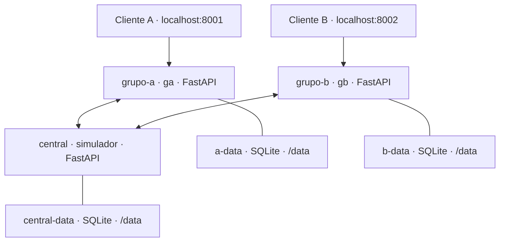

# Arquitectura de despliegue

Figura 1. Laboratorio en un equipo anfitrión: dos clientes web, dos servidores de grupo y un central simulado. El rectángulo interior representa la red de Compose. Cada servidor monta su propio volumen SQLite.

Compose crea la red por defecto del proyecto chat-distribuido-lab y resuelve central, grupo-a y grupo-b mediante DNS interno. Cada contenedor escucha en 8000. El equipo publica 127.0.0.1:8000, :8001 y :8002 para el central, ga y gb respectivamente. No hay enlace de federación directo entre ga y gb.

| Servicio | Aplicación | Volumen | Base dentro del contenedor |
|---|---|---|---|
| central | app.central_mock:app | central-data | /data/central.db |
| grupo-a | app.group:app | a-data | /data/group.db |
| grupo-b | app.group:app | b-data | /data/group.db |

El almacenamiento está dentro del volumen, no en la carpeta de resultados del repositorio. Los JSON del experimento son exportaciones para análisis. Reiniciar contenedores conserva los volúmenes; eliminarlos explícitamente borra datos.

Para conexión externa, compose.curso.yml levanta un grupo y su volumen. CENTRAL_URL apunta al central del curso y PUBLIC_URL anuncia la dirección del grupo alcanzable desde ese central. Es una configuración preparada, no evidencia de conexión oficial realizada.

Un evento se guarda con su reloj y entrada de cola en una transacción. El trabajador envía al central, que almacena y reenvía al receptor. El receptor deduplica por UUID, actualiza su reloj e incorpora el mensaje. La consulta de historial completa faltantes después de caídas.
